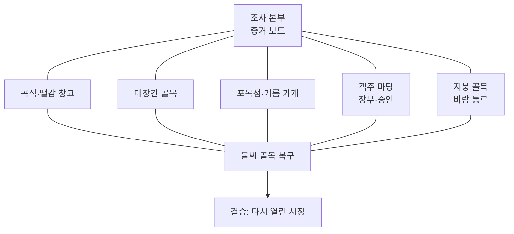

# 63. 시장 마을 불씨 조사단 — 제작 계획

- 작성: 2026-10-19, Claude(사용자 인터뷰·검토 반영). 상태: **설계 제안·미구현**. 성취기준은 사용자 제공(원문 대조 미확인). 맵 등록·게임 시험·화면 확인은 아직 하지 않았다.
- 근거: 사용자 인터뷰 답변(2026-10-19, 아래 0절), [18](18-전체맵-게임성-분석.md), [19](19-게임성-반영-기준.md), [22](22-교육내용-점검.md), 선행 계획 [58](58-등고선-지형탐험대-제작-계획.md)·[61](61-미끄럼협곡-제작-계획.md).
- 제작 담당: Codex(새 맵). 구현 기록은 `docs/64-시장마을-불씨조사단-제작.md`를 후보로 삼되, 작성 직전 최신 번호를 확인한다. 미리 빈 파일을 만들지 않는다.
- 맵 id 후보 `marketfire`, 분류 `화학`(과학 중점. `index.js`의 `SUBJECTS`에 있는 값이며, 설명은 24자 이하). 등록하면 [55 색인](55-맵-문서-색인.md)에 행을 추가해야 `maps-meta` 시험이 통과한다.

## 0. 인터뷰로 확정한 것

| 항목 | 결정 |
|---|---|
| 중심 플레이 | 자유 순서 조사. 단, 등고선 지형 탐험대와 달라야 한다 |
| 차별점 | **모은 증거로 결론 내리기** |
| 교과 | **과학 중점**(연소 조건 + 소화 원리, 6학년 `6과14`). 사회(시장 마을)는 학년과 무관한 **배경 요소** |
| 상황 | 옛 시장 마을 화재 사건. **가상 마을 + 옛날 분위기**(특정 시대·지명을 쓰지 않음) |
| 증거 | 현장 흔적·물건 관찰, 사람들의 증언·상거래 기록, 증거 간 충돌·비교 |
| 해결 방법 | 둘 다: 증거 조합이 여러 개 + 결론에 맞는 대응이 여러 개(이득과 대가) |
| 오답 | 증거 보드에서 모순 표시(정답은 알려 주지 않음). 탈락 없음·안전한 재시도 |
| 재체험 | 2~3번 반복. **다른 해결 방법**으로 달라진다 |
| 길이 | 한 판 15~25분, 기본 길 약 200~250m(설계 범위 150~250m) |
| 불 표현 | 작고 귀여운 모형. 피해자·사망·모방 행동 없음 |
| 첫 구현 범위 | **축소 첫 버전**: 현장 3곳 + 대응 3종 + 봇 걷기 시험까지 확인한 뒤 5곳·전체 길이로 확장 (4.1절) |
| 심화 내용 | 기름 화재의 물 사용 위험은 **초반에 제외**. 교육 범위 확인 뒤 선택 도전 후보로 재검토 |
| 학년·단원 | 사용자 제공: `[6과14-01]`~`[6과14-04]`(6학년군 과학 연소 관련). NCIC 원문 대조는 **미확인**. 소화 원리는 "연소 조건 하나 제거"로 확인됨(사용자). **과학 중점(`6과14-02·03`), 사회는 학년 무관 배경 요소**(사용자 방향). 사회 성취기준 코드는 표기·주장하지 않음(2.1절) |
| 진행 | 2026-10-19 Claude 검토·정리 후 커밋. 10절 지시문을 Codex에 전달해 구현 시작 |

## 1. 핵심 재미와 기존 맵과의 차이

**핵심 재미:** 마을을 돌아다니며 흔적·증언·장부를 모으고, 증거 보드에서 서로 맞춰 보며(충돌하는 증거를 가려내며) "무엇이 불을 키웠나"를 직접 결론 내린 뒤, 그 결론에 맞는 방법으로 불씨 골목을 복구해 지나간다.

| 비교 맵 | 비슷한 점 | 이 맵이 다른 점 |
|---|---|---|
| 등고선 지형 탐험대 | 자유 순서 답사, 본부에 결과 누적 | 거기는 **분포를 확인**하는 답사. 여기는 **서로 충돌하는 증거 중 믿을 것을 가려 결론을 낸다**. 결론이 이동 수단(복구 방법)을 바꾼다 |
| 메아리 탐정단 | 단서로 추리 | 거기는 신호 반사로 구조를 알아내는 탐험. 여기는 사람의 말과 기록이 틀릴 수 있다 |
| 유적 발굴 현장 | 단서 → 행동 → 결과 | 거기는 파낸 유물이 전시 길을 바꾼다. 여기는 증거 해석이 소화 방법을 정한다 |
| 산과 염기 | 화학 주제 | 거기는 지시약 색으로 길을 고르는 맵. 연소·소화는 다루지 않는다 |

## 2. 학습 내용과 표현 원칙

- **연소 조건:** 탈 물질, 산소(공기), 발화점 이상의 온도. **소화 원리:** 조건 하나를 없앤다(탈 물질 치우기, 산소 차단해 덮기, 온도 낮추기).
- **사회(배경):** 시장에서 물건이 들어오고 거래되는 기록(장부)과 사람들의 말을 근거로 사건을 이해한다. 시대·지명은 가상이다. 역사 사실처럼 보이지 않게 "옛 시장 마을 모형"임을 표기한다.
- **성취기준(사용자 제공, 2026-10-19):** 사용자가 붙여 넣은 `[6과14-01]`~`[6과14-04]`를 기준으로 삼는다. **NCIC 원문과의 대조는 아직 하지 않았다 → 미확인.** 대조 전에는 게임 화면에 코드를 쓰지 않고 문서에서만 "사용자 제공"으로 표기한다.

  | 코드 | 내용(사용자 제공 문장) | 이 맵과의 관계 |
  |---|---|---|
  | `[6과14-01]` | 물질의 성질이 달라지는 변화와 달라지지 않는 변화를 관찰하여 비교 | 보조: 탄 물건과 타지 않은 물건의 흔적 비교 |
  | `[6과14-02]` | 연소 시 공통 현상을 관찰하고 **연소의 조건**을 찾기 | **핵심**: 주된 원인 판단(열·탈 물질·공기) |
  | `[6과14-03]` | 연소 전후 물질을 비교해 성질이 달라짐을 설명 | **핵심**: 장부의 반입 물건과 현장에 남은 재·숯을 비교하는 증거 |
  | `[6과14-04]` | 연소로 생성되는 물질의 생태계 피해 사례를 수집·분석, 해결책 제안·공유 | **첫 버전 제외**. 연기·재가 마을 밖 환경에 미치는 영향은 후속 확장 후보 |

- **소화 원리(사용자 확인, 2026-10-19):** 소화는 **연소 조건 중 하나를 제거하는 방식**으로 배운다. 이 맵의 세 대응(온도 낮추기, 산소 차단, 탈 물질 치우기)이 정확히 이 구조다. 네 성취기준 문장에 "소화"라는 말은 없지만 `[6과14-02]`의 연소 조건을 뒤집어 쓰는 응용으로 설명한다. 교과서의 소화 방법 표현은 구현 전에 한 번 대조한다.
- **사회는 성취 목표가 아니라 배경이다.** 2.1절에서 사용자 제공 목록(4학년·6학년·중학교)을 대조했고, 어느 것도 대응을 주장하지 않는다.

### 2.1 사회 배경: 시장 마을

**원칙(사용자 방향, 2026-10-19): 과학을 중점으로 하고, 사회는 학년과 무관하게 배경 요소로 곁들인다.**

- 핵심 학습 목표는 과학 `6과14-02`(연소 조건), `6과14-03`(연소 전후 비교)뿐이다. 대상 학년은 과학 기준 **6학년**이다.
- 사회는 성취기준 대응을 **주장하지 않는다.** 게임 화면·교사 화면에 사회 성취기준 코드를 쓰지 않고, 평가나 단원 마무리의 학습 근거로 삼지 않는다. 교사 안내에는 "시장 마을이 배경이며, 합리적 선택·자료로 추론하기·물건의 흐름 읽기가 곁들여진다"고만 쓴다.
- 사회 요소를 더하느라 과학 증거 설계(연소 조건 판단, 연소 전후 비교)가 약해지면 사회를 줄인다.
- 옛날 분위기는 가상 마을 모형이다. 특정 시대의 5일장, 금화(화재 방지) 제도 같은 실제 역사 사실을 쓰지 않는다. 쓰려면 공신력 있는 자료로 확인하고 출처를 밝힌다.
- 시장의 기능을 체계적으로 가르치는 맵이 아니며, 경제 단원을 대신하지 않는다.

**곁들여지는 사회 요소와 참고 문장**(사용자가 제공한 4학년 `4사`·6학년 `6사`·중학교 `9사` 목록에서 닿는 것만 골랐다. 모두 **참고용이며 NCIC 원문 대조는 하지 않았다**):

| 마을의 요소 | 학생이 하는 일 | 참고 문장 |
|---|---|---|
| 현장·대응 선택의 이득과 대가 | 거리 vs 확신, 이득 vs 대가를 비교해 고른다 | `4사07-01` 합리적 선택, `9사(일사)08-01` 비용과 편익 |
| 장부 | 물건·양·출처·날짜를 읽고 현장 물건과 대조한다 | `4사07-02` 생산과 소비·물적 교류, `4사02-03` 역사 자료 분석, `4사02-02` 오래된 물건·자료 |
| 증언과 흔적의 비교 | 서로 다른 자료를 비교해 믿을 것을 가린다 | `9역01-02` 역사 탐구 방법, `4사02-03` |
| 시장 마을이라는 설정 | 물건이 모이고 거래되는 곳을 배경으로 한다 | `9사(일사)09-01` 시장 사례 |
| 복구 | 문제를 해결하는 방법을 고른다 | `4사09-01` 생활 문제의 합리적 해결, `4사08-02` 주민 참여(약함) |

**해당 없음으로 판단한 문장:**
- 6학년 목록(`6사`)에는 이 맵을 받치는 문장이 없다. `6사04-01~03`은 자료로 추론하는 방식만 같고 시대(선사·고조선·고대·고려)가 다르다. `6사05-02`(조선 후기)는 시대를 명시해야 하며 가상 마을 설정과 맞지 않아 택하지 않는다. `6사11-01`(가계·기업)은 현대 시장경제 개념이고, `6사02-01`은 기후변화 재해다.
- `4사04-01`(옛 풍습 비교)은 비교 활동이 없고, `9역12-02`(조선 후기)는 가상 마을이라 해당하지 않는다.

**설계에 곁들이는 장치(필수 조건이 아니다):**
- **합리적 선택 표시:** 현장 방문(5.1)과 대응(5.2)의 이득·대가를 화면에서 비교할 수 있게 한다. 이것은 사회 목표가 아니라 이 맵의 선택 구조(AGENTS.md의 "선택마다 이득과 대가")를 보이게 하는 일이다. 정답 숫자를 알려 주지 않는다.
- **장부 한 줄의 형식:** (물건, 양, 어디서 왔는지, 날짜). 연소 전후 비교(`6과14-03`)의 짝으로 쓰고, 출처 표기는 시장의 물건 흐름이라는 배경을 살린다. 구현 비용이 작을 때만 넣고, 어렵다면 출처 항목은 뺀다.

## 3. 사건 구성(시드마다 다름)

> 2026-10-19 검토 수정: 처음 초안은 열·탈 물질·공기 세 요소를 항상 모두 갖춘 사건이어서, 어떤 시드든 세 대응이 다 필요했다. 학생의 결론이 대응을 바꾸지 못하므로 "결론에 맞는 다른 해결 방법"이 성립하지 않는다. 아래처럼 **시드마다 주된 원인 하나**를 두는 구조로 바꿨다.

연소는 조건 하나라도 없으면 멈춘다. 불을 키운 **주된 원인**이 시드마다 한 가지 요소로 정해지고, 그 요소를 없애는 대응이 가장 효율적이다.

| 주된 원인(시드마다 하나) | 세부 물체 후보 | 가장 효율적인 대응 |
|---|---|---|
| 열(불씨가 아직 뜨거움) | 대장간 숯불 · 넘어진 등잔 · 옮겨 온 화로 | 물 끼얹기(온도 낮추기) |
| 탈 물질(번질 것이 많음) | 짚 가마니 더미 · 기름 먹인 천 · 마른 장작 | 탈 물질 치우기 |
| 공기(공기가 계속 들어옴) | 열린 뒷문 · 지붕 틈 | 젖은 멍석·모래로 덮기(산소 차단) |

주된 원인 3 × 세부 물체 2~3 = 약 8가지에 틀리는 증언 인물(3명) 중 하나를 곱한 조합이다. 학생의 결론은 **① 주된 원인 요소 ② 세부 물체** 두 칸이다. 후보가 적을수록 쉽다는 점([variants.js](../prototype/src/levels/variants.js) 머리말)을 알고, 같은 판에서는 같은 문제, 다음 판에서는 다른 문제가 나올 수 있는 정도로 둔다.

**증거 규칙(구현 시 시험으로 검증):**
- 주된 원인과 세부 물체는 각각 **서로 다른 증거 2곳 이상**에서 확인된다. 어느 한 곳을 건너뛰어도 결론에 닿을 수 있어야 한다(해결 방법 1: 증거 경로 다양).
- 증거 종류는 흔적·물건 / 증언 / 상거래 기록(장부) 세 가지. 한 가지 종류만으로 결론을 확정하지 못하게 한다.
- 증언 한 명은 시드마다 **착각**을 한다(거짓말이 아님: 시간·본 것이 틀림). 흔적이나 장부와 비교하면 가려낼 수 있어야 한다.
- 가장 많이 탄 곳(흔적), 반입량이 많은 물건(장부), 불길이 번진 방향(증언) 같은 **크기·양의 차이**가 주된 원인을 가리키게 한다. 증거 지점에 숫자 정답을 쓰지 않는다.
- **장부 한 줄의 형식(2.1절):** (물건, 양, 어디서 왔는지, 날짜). 출처가 있는 반입 기록이 탈 물질의 근거가 된다. 숫자는 비교용으로만 쓰고 정답 숫자를 보여 주지 않는다.
- **연소 전후 비교 증거(`[6과14-03]`):** 장부에 적힌 반입 물건(타기 전)과 현장에 남은 재·숯(탄 뒤)을 맞춰 보는 증거를 최소 한 쌍 둔다. 장부와 흔적이 서로를 확인해 주므로 장부가 장식에 그치지 않는다.
- 조연 요소(주된 원인이 아닌 두 요소)의 증거도 함께 놓아 "세 개 다 있었지만 무엇이 결정적이었나"를 비교하게 한다. 한 가지 요소만 가리키는 증거로 쉽게 닿지 않게 한다.

## 4. 맵 구조와 흐름



| 구간 | 목표 길이 | 핵심 행동 | 보이는 결과 → 다음 행동 |
|---|---|---|---|
| 1. 조사 본부 | 20m | 증거 보드(빈 칸 3개 + 증거 칸)를 보고 사건을 파악 | 어디부터 갈지 고름 |
| 2. 다섯 현장 | 현장당 20~25m, 합 약 100~125m | 흔적·물건 관찰, 증언 듣기, 장부 읽기. **원하는 순서로 일부만** | 모은 증거가 본부 보드 카드로 쌓임 |
| 3. 증거 보드 | 본부 왕복 포함 20m | 증거를 칸에 놓아 맞춰 보고 충돌을 가려 결론 2칸(주된 원인·세부 물체) 선택 | 틀린 칸은 모순 표시(어떤 증거와 부딪히는지만 보임). 결론은 틀려도 제출되고 복구로 간다 |
| 4. 불씨 골목 복구 | 약 50m | 결론을 바탕으로 도구를 골라 운반·설치해 불길 지점을 지나간다 | 주된 원인을 맞힌 대응은 짧고 쉬운 길, 다른 대응은 길어짐 |
| 5. 결승 | 15m | 다시 열린 시장을 통과 | 어떤 방법으로 복구했는지 마을 기록에 남음 |

길이 합은 설계 배분이다. 계획 숫자를 실제 보행 거리로 보고하지 않는다([60](60-작업-정리-2026-10-06.md): 등고선 맵은 계획 170~220m, 봇 실측 246~265m였다). **구현 뒤 봇이 걸은 거리를 재서 기록한다.**

### 4.1 첫 구현(축소 버전) 범위

| 포함 | 제외(확장 단계) |
|---|---|
| 현장 3곳(곡식·땔감 창고 / 대장간 골목 / 객주 마당)과 본부 | 포목점·지붕 골목 2곳 |
| 증거 종류 3가지(흔적·증언·장부)를 현장에 분산 | 별 전체(첫 버전은 2~3개로 도달 가능성만) |
| 주된 원인 3종(열·탈 물질·공기)과 틀리는 증언 | 세부 물체 전체 후보, 시드 조합 전체 |
| 대응 3종과 복구 골목, 증거 보드, 모순 표시 | 마을 기록(써 본 대응 표시) 등 재체험 장치 |
| 봇 걷기 시험, 걸은 거리 실측 | 교실 시험 |

- 첫 버전의 길이가 150m에 못 미칠 수 있다. 이는 확장 전 중간 단계이며 **완성 길이가 아니다**. 실측 값을 기록하고 확장 계획에 반영한다.
- 첫 버전에서 "대응별 거리·시간 차이가 실제로 있는가"와 "증거 경로를 바꿔도 같은 결론에 닿는가"가 성립하지 않으면 확장하지 않고 설계를 고친다.

## 5. 선택, 이득, 대가

### 5.1 증거 모으기(해결 방법 1)

- 현장 5곳 중 **몇 곳을 어떤 순서로** 갈지 학생이 정한다.
- **복구 구간 입장 조건은 탐험량이지 정답이 아니다:** 증거 카드가 N장(종류 2가지 이상) 모이면 증거 보드가 결론 제출을 받는다. 결론이 맞든 틀리든 제출되면 복구로 간다. 보드가 정답을 판정해 문을 여는 구조가 아니다. N은 구현 시 확정(첫 버전은 3장 정도에서 시작해 걷기 시험으로 조정).
- 이 방식으로 조사를 통째로 건너뛰는 길이 없고(조사가 핵심 활동), 정답을 맞히지 않아도 막히지 않는다(안전한 재시도).
- 이득: 많이 모으면 충돌 증언을 확실히 가려낸다. 대가: 이동 거리가 늘어난다. 적게 모으면 빨리 가지만 결론이 불확실하고 복구에서 돌아갈 수 있다.

### 5.2 결론에 맞는 대응(해결 방법 2)

세 가지 대응은 연소 조건 하나를 없애는 방법이다. 시드의 **주된 원인**에 맞는 대응이 가장 쉬운 길이다(3절 표).

| 대응 | 없애는 조건 | 이득 | 대가 | 가장 효율적인 주된 원인 |
|---|---|---|---|---|
| 물 끼얹기 | 온도 | 불길 한가운데도 식힘 | 우물까지 왕복이 김 | 열 |
| 젖은 멍석·모래 덮기 | 산소 | 가깝고 빠름, 가볍다 | 한 번에 한 곳, 틈이 있으면 다시 불씨 | 공기 |
| 탈 물질 치우기 | 탈 물질 | 확실하고 길이 새로 열림(치운 짚단 길 등) | 시간이 오래 걸림 | 탈 물질 |

- 불길 지점은 복구 골목에 3곳 안팎이고, 시드의 주된 원인에 맞는 대응이 **전체 길을 가장 짧게** 만든다. 다른 대응은 더 돌아가거나 오래 걸린다. 구현 시 대응별 보행 거리·시간 차이를 걷기 시험으로 재서 "차이가 실제로 있다"를 확인한다(차이가 없으면 이 구조는 성립하지 않는다).
- 결론이 틀려도 막히지 않는다. 비효율적인 대응으로도 지나갈 수 있지만 길이 돌아가고 작은 불씨가 다시 보인다. 안전하게 본부 보드로 복귀할 가까운 복귀 지점을 둔다.
- 별은 선택이다(≤10, 권장 4~5): 모든 현장 확인, 충돌 증언 가려내기, 서로 다른 대응 두 가지로 복구, 아직 안 써 본 대응으로 복구 등.

## 6. 재체험 설계

- 용도: **2~3번 반복**. 한 번째는 이해, 이후는 같은 사건 유형의 다른 조합으로 다른 방법을 시도한다.
- 달라지는 것: ① 시드로 사건 조합과 틀리는 증언이 바뀐다. ② **다른 해결 방법**: 이전과 다른 현장 순서·증거 조합으로 결론에 닿거나, 아직 안 써 본 대응으로 복구한다. 마을 기록에 "써 본 대응"이 표시된다.
- 보기 위치만 바뀐 것은 새 판단으로 세지 않는다.

## 7. 점검표 ([19](19-게임성-반영-기준.md) 형식)

| 항목 | 기록 |
|---|---|
| 핵심 재미 | 충돌하는 증거를 가려내 결론을 내리고, 그 결론으로 불씨 골목을 복구한다 |
| 의미 있는 선택 | 어느 현장을 갈지(거리 vs 확신), 결론 2칸(주된 원인·세부 물체), 대응 3종(이득·대가 5.2) |
| 즉시 결과 | 증거 카드가 보드에 쌓임, 결론 칸 모순 표시, 대응 성공 시 불길이 줄고 길이 열림 |
| 다음 행동·성취 | 결론이 운반할 도구와 가장 쉬운 복구 길을 정한다. **증거 보드 확인 → 문 열기 구조가 아니다**: 입장 조건은 정답이 아니라 탐험량(증거 N장)이고, 결론은 도구·길의 효율을 바꾼다 |
| 구간 변화 | 현장마다 증거 종류가 다르다(흔적/증언/장부), 복구는 이동·운반으로 요구가 바뀐다. 같은 입력 횟수 증가가 아니다 |
| 재시도 부담 | 오답은 모순 표시로 즉시 수정, 가까운 복귀 지점, 불길에 닿아도 탈락 없음 |
| 기본 완주·선택 도전 | 증거 N장 → 결론 제출(맞든 틀리든) → 어떤 대응이든 지나가면 완주. 조사는 핵심 활동이라 건너뛰는 길이 없고, 별만 선택이며 건너뛸 수 있다 |
| 친구와의 연결 | 조사 결과를 서로 설명하고 증언 충돌을 같이 비교하는 대화 기회. 협동 필수 조건은 두지 않는다 |
| 재체험 용도 | 6절 |
| 근거·관찰 | 아래 8절 |

## 8. 시험과 관찰

**자동 시험(`npm test`, 규칙·이동 검증이며 재미·학습 효과의 증거가 아님):** 
- 공통 규칙 시험(`map-rules.mjs`): 작은 발판 1.5초 안내 몇 번만, 체크포인트 2초 안정, 별 ≤10, 그 맵을 걷는 시험 파일 존재.
- 맵별 시험은 봇이 걸어서: 출발~결승 완주(최소 증거만 모은 길), 요소마다 증거 2곳 이상 확인 가능, 서로 다른 증거 경로 두 가지로 같은 결론, 틀린 결론 뒤 본부 복귀·재결론, 각 대응별 복구 완주, 대응별 보행 거리 차이, 별 도달 가능성, **걸은 총 거리 실측**.
- 시드 시험: 여러 시드에서 사건 조합이 다르고, 틀리는 증언이 가려낼 수 있는 근거를 가진다. `rngFor` 호출 순서를 바꾸면 `tests/variants-seed.mjs`에 영향이 있는지 [blast-radius](../.claude/skills/blast-radius/SKILL.md)로 점검한다.

**설계 확인(사람이 기록):** 맞게 판단하면 가장 쉬운 길이 열리는지, 선택마다 이득과 대가가 있는지, 결과가 다음 이동에 쓰이는지, 숫자 정답을 보여 주지 않는지, 시드로 외워서 풀 수 없는지, 길이가 150~250m인지.

**교실 관찰([12](12-교실-시험-관찰지.md)):** ① 충돌하는 증언을 비교해 한 증거를 의심하는 장면이 나오는가. ② 틀린 결론의 모순 표시를 보고 증거를 더 모으러 가는가, 포기하는가. ③ 두 번째 판에서 다른 증거 순서나 다른 대응을 시도하는가. 코드·봇 시험, 교사 보고, 교실 미확인을 구분해 기록한다.

## 9. 위험과 구현 전 확인

| 위험 | 대응 |
|---|---|
| **"둘 다" 구조의 크기**: 증거 경로 다양성 + 대응 3종 + 시드별 사건(주된 원인 3종 × 세부 물체 × 틀리는 증언)은 설계·검증이 가장 크다 | 첫 구현은 한 사건으로 현장 3곳 + 대응 3종만 걷기 시험까지 확인한 뒤 확장한다 |
| 증거 보드가 "결과판 확인 → 문 열기"로 굳어짐 | 보드가 길을 막지 않고, 복구 구간의 도구·운반 길이 결론에 따라 달라지게 한다(5.2) |
| 자유 순서와 결과 사용의 충돌([58](58-등고선-지형탐험대-제작-계획.md) 10.1) | 증거는 어떤 순서든 쌓이고, 결론 이후 복구에서만 결과가 쓰인다. 구현 전 Codex가 이 충돌 여부를 확인해 기록한다 |
| **대응 차이가 실제로 없을 수 있음**: 주된 원인에 맞는 대응이 다른 대응보다 짧지 않으면 결론이 이동에 쓰이지 않는다 | 첫 버전에서 대응별 걸은 거리·시간을 봇으로 재서 차이를 확인한다. 차이가 없으면 확장하지 않고 불길 지점 배치를 고친다 |
| 증언 충돌이 어려워 막힘 | 착각의 근거(흔적·장부)가 항상 반대편에 있어야 함. 모순 표시는 어느 증거와 부딪히는지 보여 준다 |
| 불·화재 표현이 무섭거나 모방 행동을 부름 | 2절의 표현 수위를 지키고 화재 진압 방법을 흉내 내라는 안내를 쓰지 않는다 |
| 장부(사회 배경)가 장식에 그침 | 장부가 결론의 근거가 되어야 한다(장부 없이 닿는 증거 경로만 두지 않기). 단, 장부만이 유일한 경로가 되지 않게 한다 |
| 과학 성취기준 원문 미대조 | 구현 전 NCIC 원문 대조. 소화는 연소 조건 제거 방식으로 확정. 사회는 배경으로만 두고 코드를 표기하지 않는다. 대상 학년은 과학 기준 6학년 |
| 사회 배경 요소가 과학 증거 설계를 약하게 함 | 충돌 시 사회를 줄인다. 이득·대가 비교 표시도 정답 숫자는 노출하지 않는다 |
| `[6과14-04]`(생태계 피해) 요구가 빠짐 | 첫 버전 제외를 기록하고, 교사가 이 맵을 단원 마무리에 쓸지 판단할 때 알 수 있게 한다. 후속 확장은 "연기·재가 마을 밖에 미치는 영향" 한 구간 후보 |
| 공통 파일 수정 필요 시 | `kit.js`·`variants.js` 등을 바꾸면 blast-radius 점검을 하고 변경 범위와 호환 영향을 기록한다 |

## 10. Codex 제작 지시문

이 절은 위 1~9절을 바탕으로 쓴 지시문이다. 문서와 어긋나면 **문서(1~9절)가 우선**한다.

```
새 맵 "시장 마을 불씨 조사단"(id 후보 marketfire)의 첫 구현(축소 버전)을 만든다.

[먼저 읽을 것]
AGENTS.md, docs/63(이 계획서 전체), docs/19(게임성 점검표), docs/55(맵 색인),
docs/58 10절(자유 순서와 결과 사용의 충돌), docs/59(등고선 맵 구현 기록과 걷기 시험 방식).
작업 전 git status를 확인한다. 다른 에이전트의 미커밋 변경(예: 미끄럼 협곡의 physics.js, player.js)이
있으면 건드리지 않는다.

[핵심 재미]
마을을 돌며 흔적·증언·장부를 모으고, 충돌하는 증거를 가려내 "무엇이 불을 키웠나"를 결론 내린 뒤,
그 결론에 맞는 소화 방법으로 불씨 골목을 복구해 지나간다.
등고선 지형 탐험대(분포 확인)와 달리 증거가 서로 충돌하고, 결론이 이동 수단을 바꾼다.

[학습 내용(2.1절)]
- 과학 중점: 연소 조건(탈 물질·산소·발화점 이상의 온도)으로 주된 원인을 판단(6과14-02),
  장부의 반입 물건(타기 전)과 현장의 재·숯(탄 뒤)을 비교(6과14-03).
  소화는 "연소 조건 하나를 제거"한다: 물 끼얹기(온도), 젖은 멍석·모래 덮기(산소), 탈 물질 치우기.
- 사회는 학년과 무관한 배경이다. 성취기준 코드를 게임 화면·교사 화면에 쓰지 않는다.
  과학 성취기준 코드도 NCIC 대조 전이므로 화면에 쓰지 않는다. 문서에서는 "사용자 제공"으로만 표기한다.
- 기름 화재의 물 사용 위험 등 심화 내용은 넣지 않는다. 6과14-04(생태계 피해)는 첫 버전에서 제외한다.

[사건 구조(3절)]
- 시드마다 "주된 원인 한 가지(열/탈 물질/공기) + 세부 물체"가 다르다. 주된 원인과 세부 물체는
  각각 서로 다른 증거 2곳 이상, 서로 다른 종류(흔적·증언·장부)로 확인된다.
- 증언 한 명은 시드마다 착각(거짓말 아님)하며 흔적·장부와 비교하면 가려낼 수 있다.
- 크기·양의 차이(가장 많이 탄 곳, 반입량 등)가 주된 원인을 가리킨다. 정답 숫자를 그대로 보여 주지 않는다.
- 장부 한 줄은 (물건, 양, 어디서 왔는지, 날짜). 구현이 어려우면 출처 항목은 뺀다.
- 연소 전후 비교 증거(장부 반입 물건 ↔ 현장 재·숯)를 최소 한 쌍 둔다.

[흐름과 선택(4~5절)]
- 현장은 자유 순서. 복구 입장 조건은 정답이 아니라 탐험량(증거 카드 N장, 2종류 이상, 첫 버전은 3장 정도에서 시작)이다.
  결론 2칸(주된 원인·세부 물체)은 맞든 틀리든 제출되고 복구로 간다. 보드가 정답을 판정해 문을 여는 구조로 만들지 않는다.
- 틀린 칸은 모순 표시(어느 증거와 부딪히는지만 보임, 정답 비공개).
- 복구 골목의 불길 지점은 3곳 안팎. 시드의 주된 원인에 맞는 대응이 전체 길을 가장 짧게 만든다.
  다른 대응은 더 돌아가거나 오래 걸리지만 지나갈 수 있다. 틀리면 작은 불씨가 다시 보이고
  가까운 복귀 지점으로 안전하게 본부 보드로 돌아올 수 있다.
- 현장 방문과 대응의 이득·대가를 화면에서 비교할 수 있게 표시한다(정답 숫자 금지).

[첫 구현 범위(4.1절)]
- 포함: 현장 3곳(곡식·땔감 창고 / 대장간 골목 / 객주 마당)과 본부, 증거 3종류, 주된 원인 3종과
  틀리는 증언, 대응 3종, 복구 골목, 증거 보드, 모순 표시, 봇 걷기 시험, 걸은 거리 실측.
- 제외: 포목점·지붕 골목, 세부 물체 전체와 시드 조합 전체, 마을 기록(써 본 대응) 같은 재체험 장치.
  별은 2~3개로 도달 가능성만 확인(최대 10개 이하).
- 첫 버전이 150m에 못 미쳐도 된다(완성 길이 아님). 실측 값을 기록한다.
- "대응별 걸은 거리·시간 차이가 실제로 있는가", "증거 경로를 바꿔도 같은 결론에 닿는가"가 성립하지 않으면
  확장하지 않고 설계를 고쳐 기록한다.

[교실 규칙]
탈락 없음, 밀치기·잡기 없음, 조작 부담 완화, 안전한 재시도, 가까운 복귀 지점.
불은 작고 귀여운 모형이며 닿아도 피해·탈락이 없다. 피해자·모방 행동 없음.
기본 완주는 별과 무관하다. 별은 건너뛸 수 있는 선택이다.

[시험(AGENTS.md "맵 시험 규칙")]
- prototype에서 npm test. 새 맵을 index.js에 등록하면 map-rules.mjs가 자동 검사한다.
  (작은 발판 1.5초 안내 몇 번만, 체크포인트 2초 안정, 별 ≤10, 그 맵을 걷는 시험 파일 존재)
- 맵별 시험은 봇이 run(...)으로 걷는다: 출발~결승 완주(최소 증거 길), 요소마다 증거 2곳 이상 확인 가능,
  서로 다른 증거 경로로 같은 결론, 틀린 결론 뒤 본부 복귀·재결론, 각 대응별 복구 완주와 걸은 거리 차이,
  별 도달 가능성, 걸은 총 거리 실측. 시드 여러 개에서 사건이 다르고 틀리는 증언을 가려낼 근거가 있다.
- 걸어서 올라서는 턱은 0.15m 안팎. 메시 scale을 바꾸면 충돌 상자도 바뀌므로 모양 단서는 장식용 자식 메시로.
- 등록하면 docs/55 색인에 행을 추가한다(maps-meta 시험). 분류는 화학, 설명은 24자 이하.
- 공통 파일(kit.js, variants.js, physics.js 등)을 바꿔야 하면 .claude/skills/blast-radius/SKILL.md를
  따르고 변경 범위와 호환 영향을 기록한다. rngFor/shuffled/pick을 바꾸면 tests/variants-seed.mjs가 실패한다.

[기록과 보고]
- docs/64-시장마을-불씨조사단-제작.md (번호는 작성 직전 최신 확인, 빈 파일 미리 만들지 않음).
  docs/19 점검표와 교실에서 관찰할 항목(8절)을 포함한다.
- 코드·봇 시험 / 교사 보고 / 화면·교실 미확인을 구분해 적는다.
  자동 시험 통과를 재미·학습 효과의 증거로 쓰지 않는다. 계획 숫자를 실제 보행 거리로 보고하지 않는다.
- 커밋은 이 작업의 파일만 경로를 지정해 올린다(git add -A 금지: 다른 에이전트의 작업 파일 혼입 방지, docs/60).
```

## 변경 이력

| 날짜 | 담당 | 내용 | 근거 |
|---|---|---|---|
| 2026-10-19 | Claude | 사용자 인터뷰 답변으로 초안 작성 | 0절 |
| 2026-10-19 | Claude | 검토 수정: ① 사건 구조를 "시드마다 주된 원인 한 가지"로 바꿔 결론이 대응을 바꾸게 함(3절) ② 복구 입장 조건을 정답이 아닌 탐험량으로 정리해 "길을 막지 않음"과 "조사 필수"의 모순 해소(5.1절) ③ 첫 구현 범위·제외 확정(4.1절) | 사용자 인터뷰(축소 첫 버전, 심화 제외), 문서 검토 |
| 2026-10-19 | Claude | 사용자 제공 과학 성취기준 `[6과14-01~04]` 반영: 핵심 02·03, 04 제외, 연소 전후 비교 증거 추가 | 사용자 입력(원문 대조 미수행) |
| 2026-10-19 | Claude | 소화 원리 확정(연소 조건 하나 제거) | 사용자 답변 |
| 2026-10-19 | Claude | 사용자 제공 사회 성취기준 대조(6학년 → 4학년 → 중학교 목록). 6학년 목록은 직접 대응 없음, 4학년은 배경 후보 다수 | 사용자 입력(원문 대조 미수행) |
| 2026-10-19 | Claude | 사용자 방향 반영: "과학 중점, 사회는 학년 무관 배경". 사회를 핵심에서 배경으로 낮추고 학년군 불일치 해소(대상 학년은 과학 기준 6학년), 사회 코드 비표기 | 사용자 지시 |
| 2026-10-19 | Claude | 문서 정리: 2.1절 재구성, 낡은 표현(핵심 후보·18조합·분류·진행 상태) 수정, 10절 Codex 지시문을 문서 내용에 맞춰 재작성, 변경 이력 정렬 | 사용자 지시("커밋하고 문서화") |
