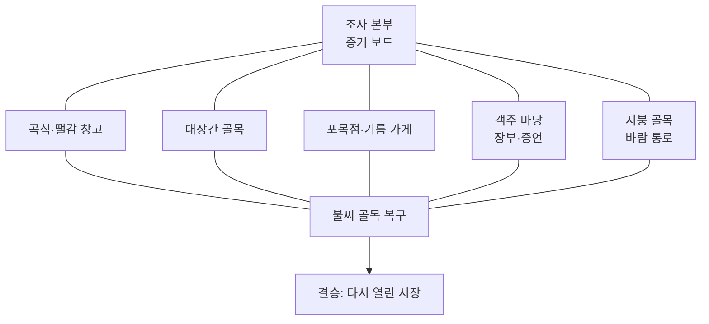

# 63. 시장 마을 불씨 조사단 — 제작 계획

- 작성: 2026-10-19, Claude(사용자 인터뷰·검토 반영). 상태: **설계 제안·미구현**. 학년·단원은 사용자 입력 대기. 맵 등록·게임 시험·화면 확인은 아직 하지 않았다.
- 근거: 사용자 인터뷰 답변(2026-10-19, 아래 0절), [18](18-전체맵-게임성-분석.md), [19](19-게임성-반영-기준.md), [22](22-교육내용-점검.md), 선행 계획 [58](58-등고선-지형탐험대-제작-계획.md)·[61](61-미끄럼협곡-제작-계획.md).
- 제작 담당: Codex(새 맵). 구현 기록은 `docs/64-시장마을-불씨조사단-제작.md`를 후보로 삼되, 작성 직전 최신 번호를 확인한다. 미리 빈 파일을 만들지 않는다.
- 맵 id 후보 `marketfire`, 분류 `사회`(또는 `화학`. `index.js`의 `SUBJECTS`에서 고르고 설명은 24자 이하). 등록하면 [55 색인](55-맵-문서-색인.md)에 행을 추가해야 `maps-meta` 시험이 통과한다.

## 0. 인터뷰로 확정한 것

| 항목 | 결정 |
|---|---|
| 중심 플레이 | 자유 순서 조사. 단, 등고선 지형 탐험대와 달라야 한다 |
| 차별점 | **모은 증거로 결론 내리기** |
| 교과 | 5~6학년을 넘나듦. 과학(연소 조건 + 소화 원리) + 사회(상거래·시장 마을) 혼재 |
| 상황 | 옛 시장 마을 화재 사건. **가상 마을 + 옛날 분위기**(특정 시대·지명을 쓰지 않음) |
| 증거 | 현장 흔적·물건 관찰, 사람들의 증언·상거래 기록, 증거 간 충돌·비교 |
| 해결 방법 | 둘 다: 증거 조합이 여러 개 + 결론에 맞는 대응이 여러 개(이득과 대가) |
| 오답 | 증거 보드에서 모순 표시(정답은 알려 주지 않음). 탈락 없음·안전한 재시도 |
| 재체험 | 2~3번 반복. **다른 해결 방법**으로 달라진다 |
| 길이 | 한 판 15~25분, 기본 길 약 200~250m(설계 범위 150~250m) |
| 불 표현 | 작고 귀여운 모형. 피해자·사망·모방 행동 없음 |
| 첫 구현 범위 | **축소 첫 버전**: 현장 3곳 + 대응 3종 + 봇 걷기 시험까지 확인한 뒤 5곳·전체 길이로 확장 (4.1절) |
| 심화 내용 | 기름 화재의 물 사용 위험은 **초반에 제외**. 교육 범위 확인 뒤 선택 도전 후보로 재검토 |
| 학년·단원 | 사용자가 알고 있다고 답함. **입력 대기 중 → 확인 전까지 성취기준 코드 표기 금지** |
| 진행 | 2026-10-19 Claude 검토 후 이 문서만 커밋. Codex 전달은 별도 결정 |

## 1. 핵심 재미와 기존 맵과의 차이

**핵심 재미:** 마을을 돌아다니며 흔적·증언·장부를 모으고, 증거 보드에서 서로 맞춰 보며(충돌하는 증거를 가려내며) "무엇이 불을 키웠나"를 직접 결론 내린 뒤, 그 결론에 맞는 방법으로 불씨 골목을 복구해 지나간다.

| 비교 맵 | 비슷한 점 | 이 맵이 다른 점 |
|---|---|---|
| 등고선 지형 탐험대 | 자유 순서 답사, 본부에 결과 누적 | 거기는 **분포를 확인**하는 답사. 여기는 **서로 충돌하는 증거 중 믿을 것을 가려 결론을 낸다**. 결론이 이동 수단(복구 방법)을 바꾼다 |
| 메아리 탐정단 | 단서로 추리 | 거기는 신호 반사로 구조를 알아내는 탐험. 여기는 사람의 말과 기록이 틀릴 수 있다 |
| 유적 발굴 현장 | 단서 → 행동 → 결과 | 거기는 파낸 유물이 전시 길을 바꾼다. 여기는 증거 해석이 소화 방법을 정한다 |
| 산과 염기 | 화학 주제 | 거기는 지시약 색으로 길을 고르는 맵. 연소·소화는 다루지 않는다 |

## 2. 학습 내용과 표현 원칙

- **연소 조건:** 탈 물질, 산소(공기), 발화점 이상의 온도. **소화 원리:** 조건 하나를 없앤다(탈 물질 치우기, 산소 차단해 덮기, 온도 낮추기).
- **사회:** 시장에서 물건이 들어오고 거래되는 기록(장부)과 사람들의 말을 근거로 사건을 이해한다. 시대·지명은 가상이다. 역사 사실처럼 보이지 않게 "옛 시장 마을 모형"임을 표기한다.
- **성취기준·교과서 단원은 이 문서에서 확정하지 않는다.** 5~6학년 어느 단원·성취기준에 해당하는지 구현 전 교육과정 원문(NCIC)과 대조한다 → **미확인**. 대조 전에는 화면·문서에 성취기준 코드를 쓰지 않는다.
- 실제 화재 진압 매뉴얼이나 소방 안전 교육을 대신하지 않는다. 기름 화재의 물 사용 같은 심화 내용은 첫 버전에서 제외한다(교육 범위 미확인).
- 정답 숫자를 보여 주지 않는다. 결론은 말이 아니라 칸 선택(그림 카드)이다.
- 불·화재 표현: 작고 귀여운 모형. 불꽃은 장식이며 닿아도 피해·탈락이 없다. 불길이 막는 길은 소화·예방으로만 열린다.

## 3. 사건 구성(시드마다 다름)

> 2026-10-19 검토 수정: 처음 초안은 열·탈 물질·공기 세 요소를 항상 모두 갖춘 사건이어서, 어떤 시드든 세 대응이 다 필요했다. 학생의 결론이 대응을 바꾸지 못하므로 "결론에 맞는 다른 해결 방법"이 성립하지 않는다. 아래처럼 **시드마다 주된 원인 하나**를 두는 구조로 바꿨다.

연소는 조건 하나라도 없으면 멈춘다. 불을 키운 **주된 원인**이 시드마다 한 가지 요소로 정해지고, 그 요소를 없애는 대응이 가장 효율적이다.

| 주된 원인(시드마다 하나) | 세부 물체 후보 | 가장 효율적인 대응 |
|---|---|---|
| 열(불씨가 아직 뜨거움) | 대장간 숯불 · 넘어진 등잔 · 옮겨 온 화로 | 물 끼얹기(온도 낮추기) |
| 탈 물질(번질 것이 많음) | 짚 가마니 더미 · 기름 먹인 천 · 마른 장작 | 탈 물질 치우기 |
| 공기(공기가 계속 들어옴) | 열린 뒷문 · 지붕 틈 | 젖은 멍석·모래로 덮기(산소 차단) |

주된 원인 3 × 세부 물체 2~3 = 약 8가지에 틀리는 증언 인물(3명) 중 하나를 곱한 조합이다. 학생의 결론은 **① 주된 원인 요소 ② 세부 물체** 두 칸이다. 후보가 적을수록 쉽다는 점([variants.js](../prototype/src/levels/variants.js) 머리말)을 알고, 같은 판에서는 같은 문제, 다음 판에서는 다른 문제가 나올 수 있는 정도로 둔다.

**증거 규칙(구현 시 시험으로 검증):**
- 주된 원인과 세부 물체는 각각 **서로 다른 증거 2곳 이상**에서 확인된다. 어느 한 곳을 건너뛰어도 결론에 닿을 수 있어야 한다(해결 방법 1: 증거 경로 다양).
- 증거 종류는 흔적·물건 / 증언 / 상거래 기록(장부) 세 가지. 한 가지 종류만으로 결론을 확정하지 못하게 한다.
- 증언 한 명은 시드마다 **착각**을 한다(거짓말이 아님: 시간·본 것이 틀림). 흔적이나 장부와 비교하면 가려낼 수 있어야 한다.
- 가장 많이 탄 곳(흔적), 반입량이 많은 물건(장부), 불길이 번진 방향(증언) 같은 **크기·양의 차이**가 주된 원인을 가리키게 한다. 증거 지점에 숫자 정답을 쓰지 않는다.
- 조연 요소(주된 원인이 아닌 두 요소)의 증거도 함께 놓아 "세 개 다 있었지만 무엇이 결정적이었나"를 비교하게 한다. 한 가지 요소만 가리키는 증거로 쉽게 닿지 않게 한다.

## 4. 맵 구조와 흐름



| 구간 | 목표 길이 | 핵심 행동 | 보이는 결과 → 다음 행동 |
|---|---|---|---|
| 1. 조사 본부 | 20m | 증거 보드(빈 칸 3개 + 증거 칸)를 보고 사건을 파악 | 어디부터 갈지 고름 |
| 2. 다섯 현장 | 현장당 20~25m, 합 약 100~125m | 흔적·물건 관찰, 증언 듣기, 장부 읽기. **원하는 순서로 일부만** | 모은 증거가 본부 보드 카드로 쌓임 |
| 3. 증거 보드 | 본부 왕복 포함 20m | 증거를 칸에 놓아 맞춰 보고 충돌을 가려 결론 2칸(주된 원인·세부 물체) 선택 | 틀린 칸은 모순 표시(어떤 증거와 부딪히는지만 보임). 결론은 틀려도 제출되고 복구로 간다 |
| 4. 불씨 골목 복구 | 약 50m | 결론을 바탕으로 도구를 골라 운반·설치해 불길 지점을 지나간다 | 주된 원인을 맞힌 대응은 짧고 쉬운 길, 다른 대응은 길어짐 |
| 5. 결승 | 15m | 다시 열린 시장을 통과 | 어떤 방법으로 복구했는지 마을 기록에 남음 |

길이 합은 설계 배분이다. 계획 숫자를 실제 보행 거리로 보고하지 않는다([60](60-작업-정리-2026-10-06.md): 등고선 맵은 계획 170~220m, 봇 실측 246~265m였다). **구현 뒤 봇이 걸은 거리를 재서 기록한다.**

### 4.1 첫 구현(축소 버전) 범위

| 포함 | 제외(확장 단계) |
|---|---|
| 현장 3곳(곡식·땔감 창고 / 대장간 골목 / 객주 마당)과 본부 | 포목점·지붕 골목 2곳 |
| 증거 종류 3가지(흔적·증언·장부)를 현장에 분산 | 별 전체(첫 버전은 2~3개로 도달 가능성만) |
| 주된 원인 3종(열·탈 물질·공기)과 틀리는 증언 | 세부 물체 전체 후보, 시드 조합 전체 |
| 대응 3종과 복구 골목, 증거 보드, 모순 표시 | 마을 기록(써 본 대응 표시) 등 재체험 장치 |
| 봇 걷기 시험, 걸은 거리 실측 | 교실 시험 |

- 첫 버전의 길이가 150m에 못 미칠 수 있다. 이는 확장 전 중간 단계이며 **완성 길이가 아니다**. 실측 값을 기록하고 확장 계획에 반영한다.
- 첫 버전에서 "대응별 거리·시간 차이가 실제로 있는가"와 "증거 경로를 바꿔도 같은 결론에 닿는가"가 성립하지 않으면 확장하지 않고 설계를 고친다.

## 5. 선택, 이득, 대가

### 5.1 증거 모으기(해결 방법 1)

- 현장 5곳 중 **몇 곳을 어떤 순서로** 갈지 학생이 정한다.
- **복구 구간 입장 조건은 탐험량이지 정답이 아니다:** 증거 카드가 N장(종류 2가지 이상) 모이면 증거 보드가 결론 제출을 받는다. 결론이 맞든 틀리든 제출되면 복구로 간다. 보드가 정답을 판정해 문을 여는 구조가 아니다. N은 구현 시 확정(첫 버전은 3장 정도에서 시작해 걷기 시험으로 조정).
- 이 방식으로 조사를 통째로 건너뛰는 길이 없고(조사가 핵심 활동), 정답을 맞히지 않아도 막히지 않는다(안전한 재시도).
- 이득: 많이 모으면 충돌 증언을 확실히 가려낸다. 대가: 이동 거리가 늘어난다. 적게 모으면 빨리 가지만 결론이 불확실하고 복구에서 돌아갈 수 있다.

### 5.2 결론에 맞는 대응(해결 방법 2)

세 가지 대응은 연소 조건 하나를 없애는 방법이다. 시드의 **주된 원인**에 맞는 대응이 가장 쉬운 길이다(3절 표).

| 대응 | 없애는 조건 | 이득 | 대가 | 가장 효율적인 주된 원인 |
|---|---|---|---|---|
| 물 끼얹기 | 온도 | 불길 한가운데도 식힘 | 우물까지 왕복이 김 | 열 |
| 젖은 멍석·모래 덮기 | 산소 | 가깝고 빠름, 가볍다 | 한 번에 한 곳, 틈이 있으면 다시 불씨 | 공기 |
| 탈 물질 치우기 | 탈 물질 | 확실하고 길이 새로 열림(치운 짚단 길 등) | 시간이 오래 걸림 | 탈 물질 |

- 불길 지점은 복구 골목에 3곳 안팎이고, 시드의 주된 원인에 맞는 대응이 **전체 길을 가장 짧게** 만든다. 다른 대응은 더 돌아가거나 오래 걸린다. 구현 시 대응별 보행 거리·시간 차이를 걷기 시험으로 재서 "차이가 실제로 있다"를 확인한다(차이가 없으면 이 구조는 성립하지 않는다).
- 결론이 틀려도 막히지 않는다. 비효율적인 대응으로도 지나갈 수 있지만 길이 돌아가고 작은 불씨가 다시 보인다. 안전하게 본부 보드로 복귀할 가까운 복귀 지점을 둔다.
- 별은 선택이다(≤10, 권장 4~5): 모든 현장 확인, 충돌 증언 가려내기, 서로 다른 대응 두 가지로 복구, 아직 안 써 본 대응으로 복구 등.

## 6. 재체험 설계

- 용도: **2~3번 반복**. 한 번째는 이해, 이후는 같은 사건 유형의 다른 조합으로 다른 방법을 시도한다.
- 달라지는 것: ① 시드로 사건 조합과 틀리는 증언이 바뀐다. ② **다른 해결 방법**: 이전과 다른 현장 순서·증거 조합으로 결론에 닿거나, 아직 안 써 본 대응으로 복구한다. 마을 기록에 "써 본 대응"이 표시된다.
- 보기 위치만 바뀐 것은 새 판단으로 세지 않는다.

## 7. 점검표 ([19](19-게임성-반영-기준.md) 형식)

| 항목 | 기록 |
|---|---|
| 핵심 재미 | 충돌하는 증거를 가려내 결론을 내리고, 그 결론으로 불씨 골목을 복구한다 |
| 의미 있는 선택 | 어느 현장을 갈지(거리 vs 확신), 결론 2칸(주된 원인·세부 물체), 대응 3종(이득·대가 5.2) |
| 즉시 결과 | 증거 카드가 보드에 쌓임, 결론 칸 모순 표시, 대응 성공 시 불길이 줄고 길이 열림 |
| 다음 행동·성취 | 결론이 운반할 도구와 가장 쉬운 복구 길을 정한다. **증거 보드 확인 → 문 열기 구조가 아니다**: 입장 조건은 정답이 아니라 탐험량(증거 N장)이고, 결론은 도구·길의 효율을 바꾼다 |
| 구간 변화 | 현장마다 증거 종류가 다르다(흔적/증언/장부), 복구는 이동·운반으로 요구가 바뀐다. 같은 입력 횟수 증가가 아니다 |
| 재시도 부담 | 오답은 모순 표시로 즉시 수정, 가까운 복귀 지점, 불길에 닿아도 탈락 없음 |
| 기본 완주·선택 도전 | 증거 N장 → 결론 제출(맞든 틀리든) → 어떤 대응이든 지나가면 완주. 조사는 핵심 활동이라 건너뛰는 길이 없고, 별만 선택이며 건너뛸 수 있다 |
| 친구와의 연결 | 조사 결과를 서로 설명하고 증언 충돌을 같이 비교하는 대화 기회. 협동 필수 조건은 두지 않는다 |
| 재체험 용도 | 6절 |
| 근거·관찰 | 아래 8절 |

## 8. 시험과 관찰

**자동 시험(`npm test`, 규칙·이동 검증이며 재미·학습 효과의 증거가 아님):** 
- 공통 규칙 시험(`map-rules.mjs`): 작은 발판 1.5초 안내 몇 번만, 체크포인트 2초 안정, 별 ≤10, 그 맵을 걷는 시험 파일 존재.
- 맵별 시험은 봇이 걸어서: 출발~결승 완주(최소 증거만 모은 길), 요소마다 증거 2곳 이상 확인 가능, 서로 다른 증거 경로 두 가지로 같은 결론, 틀린 결론 뒤 본부 복귀·재결론, 각 대응별 복구 완주, 대응별 보행 거리 차이, 별 도달 가능성, **걸은 총 거리 실측**.
- 시드 시험: 여러 시드에서 사건 조합이 다르고, 틀리는 증언이 가려낼 수 있는 근거를 가진다. `rngFor` 호출 순서를 바꾸면 `tests/variants-seed.mjs`에 영향이 있는지 [blast-radius](../.claude/skills/blast-radius/SKILL.md)로 점검한다.

**설계 확인(사람이 기록):** 맞게 판단하면 가장 쉬운 길이 열리는지, 선택마다 이득과 대가가 있는지, 결과가 다음 이동에 쓰이는지, 숫자 정답을 보여 주지 않는지, 시드로 외워서 풀 수 없는지, 길이가 150~250m인지.

**교실 관찰([12](12-교실-시험-관찰지.md)):** ① 충돌하는 증언을 비교해 한 증거를 의심하는 장면이 나오는가. ② 틀린 결론의 모순 표시를 보고 증거를 더 모으러 가는가, 포기하는가. ③ 두 번째 판에서 다른 증거 순서나 다른 대응을 시도하는가. 코드·봇 시험, 교사 보고, 교실 미확인을 구분해 기록한다.

## 9. 위험과 구현 전 확인

| 위험 | 대응 |
|---|---|
| **"둘 다" 구조의 크기**: 증거 경로 다양성 + 대응 3종 + 시드 18조합은 설계·검증이 가장 크다 | 첫 구현은 한 사건으로 현장 3곳 + 대응 3종만 걷기 시험까지 확인한 뒤 확장한다 |
| 증거 보드가 "결과판 확인 → 문 열기"로 굳어짐 | 보드가 길을 막지 않고, 복구 구간의 도구·운반 길이 결론에 따라 달라지게 한다(5.2) |
| 자유 순서와 결과 사용의 충돌([58](58-등고선-지형탐험대-제작-계획.md) 10.1) | 증거는 어떤 순서든 쌓이고, 결론 이후 복구에서만 결과가 쓰인다. 구현 전 Codex가 이 충돌 여부를 확인해 기록한다 |
| **대응 차이가 실제로 없을 수 있음**: 주된 원인에 맞는 대응이 다른 대응보다 짧지 않으면 결론이 이동에 쓰이지 않는다 | 첫 버전에서 대응별 걸은 거리·시간을 봇으로 재서 차이를 확인한다. 차이가 없으면 확장하지 않고 불길 지점 배치를 고친다 |
| 증언 충돌이 어려워 막힘 | 착각의 근거(흔적·장부)가 항상 반대편에 있어야 함. 모순 표시는 어느 증거와 부딪히는지 보여 준다 |
| 불·화재 표현이 무섭거나 모방 행동을 부름 | 2절의 표현 수위를 지키고 화재 진압 방법을 흉내 내라는 안내를 쓰지 않는다 |
| 사회 연계가 장식에 그침 | 장부가 결론에 필요한 근거가 되어야 한다(장부 없이 닿는 증거 경로만 두지 않기). 단, 장부만이 유일한 경로가 되지 않게 한다 |
| 성취기준·교과 단원 미확인 | 구현 전 원문 대조. 대조 전에는 표기하지 않는다 |
| 공통 파일 수정 필요 시 | `kit.js`·`variants.js` 등을 바꾸면 blast-radius 점검을 하고 변경 범위와 호환 영향을 기록한다 |

## 10. Codex 제작 지시문

```
새 맵 "시장 마을 불씨 조사단"(id 후보 marketfire)을 만든다.

먼저 읽을 것: AGENTS.md, docs/63(이 계획서), docs/19(점검표), docs/55(맵 색인),
docs/58 10절(자유 순서와 결과 사용의 충돌), docs/59(등고선 맵 구현 기록).

핵심 재미: 마을을 돌며 흔적·증언·장부를 모으고, 충돌하는 증거를 가려내 결론을 내린 뒤
그 결론에 맞는 소화 방법으로 불씨 골목을 복구해 지나간다.
기존 맵과의 차이: 등고선(분포 확인)과 달리 증거가 서로 충돌하고, 결론이 이동 수단을 바꾼다.

반드시 지킬 것:
- 사건은 시드마다 "주된 원인 한 가지(열/탈 물질/공기) + 세부 물체"로 다르다(3절).
  주된 원인과 세부 물체는 각각 서로 다른 증거 2곳 이상으로 확인된다.
  증언 한 명은 시드마다 착각하며 흔적·장부로 가려낼 수 있다.
- 복구 입장 조건은 정답이 아니라 증거 카드 N장(2종류 이상). 결론은 맞든 틀리든 제출된다.
  주된 원인에 맞는 대응이 복구 골목 전체를 가장 짧게 만든다(대응별 걸은 거리 차이를 시험으로 확인).
  틀리면 모순 표시(정답 비공개), 작은 불씨가 다시 보이고, 가까운 복귀 지점으로 안전하게 돌아온다.
- 기본 완주는 별과 무관. 별 ≤10(권장 4~5)은 건너뛸 수 있는 선택.
- 탈락 없음, 밀치기·잡기 없음, 불은 작고 귀여운 모형이며 닿아도 피해 없음.
- 숫자 정답 표시 금지. 성취기준 코드는 NCIC 대조 전 표기 금지.
- 길이: 설계 150~250m. 봇이 걸은 거리를 재서 기록(계획 숫자 보고 금지).
- 첫 구현은 4.1절 범위(현장 3곳 + 대응 3종 + 걷기 시험)까지 확인한 뒤 확장.
  대응별 걸은 거리 차이가 없으면 확장하지 않고 설계를 고친다.
- 기름 화재의 물 사용 위험 등 심화 내용은 넣지 않는다.

시험: prototype에서 npm test. 맵별 시험은 봇이 걸어 기본 길 완주, 선택별 결과 차이,
틀린 선택 뒤 복귀, 별 도달을 확인. 등록하면 docs/55 색인 행도 추가.
기록: docs/64(번호 확인), docs/19 점검표와 관찰 항목 포함.
자동 시험 통과를 재미·학습 효과의 증거로 쓰지 말고, 코드 확인/교사 보고/미확인을 구분.
```

## 변경 이력

| 날짜 | 담당 | 내용 | 근거 |
|---|---|---|---|
| 2026-10-19 | Claude | 사용자 인터뷰 답변으로 초안 작성 | 0절 |
| 2026-10-19 | Claude | 검토 수정: ① 사건 구조를 "시드마다 주된 원인 한 가지"로 바꿔 결론이 대응을 바꾸게 함(3절) ② 복구 입장 조건을 정답이 아닌 탐험량으로 정리해 "길을 막지 않음"과 "조사 필수"의 모순 해소(5.1절) ③ 첫 구현 범위·제외 확정(4.1절) | 사용자 인터뷰(축소 첫 버전, 심화 제외), 문서 검토 |
